# MTG Life Counter

Contador de vida para Magic: The Gathering numa tela redonda de 1,28", feito com o
**Seeed Studio XIAO nRF52840** e a **Round Display for XIAO**. Funciona na bateria, salva
tudo sozinho e aceita temas personalizados enviados do celular por Bluetooth.

<p align="center">
  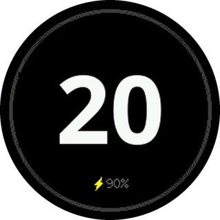
  
  
</p>

## Como usar

| Gesto | O que faz |
|---|---|
| Arrastar o dedo na borda | horário +1, anti-horário −1 (24 pontos por volta) |
| Tocar à direita / esquerda do número | +1 / −1 |
| Segurar à direita / esquerda | +10 / −10, repetindo |
| Tocar no centro | abre o menu |

O número muda de cor conforme a vida cai (amarelo ≤ 10, laranja ≤ 5, vermelho ≤ 0), um
"+3" / "−2" mostra a última mudança e a bateria aparece embaixo (o raio indica USB ligado).

### Temas

Seis temas vêm no firmware (padrão e as cores de mana W/U/B/R/G) e há dois espaços para
temas criados no site.

<p align="center">
  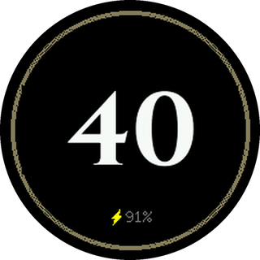
  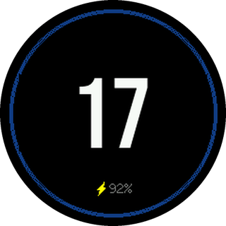
  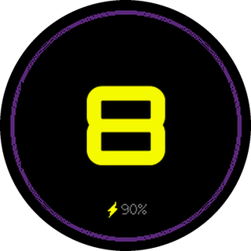
  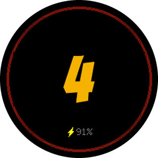
  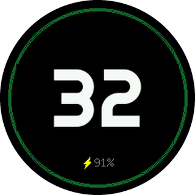
</p>

Os temas personalizados são feitos no editor
**[joaopedropio.github.io/mtg-life](https://joaopedropio.github.io/mtg-life/)**: escolha uma base,
mude cores, efeito do número ou use uma foto de fundo, e envie pelo Bluetooth. Funciona no
Chrome/Edge (Android, Windows, Mac, Linux); no iPhone use o app gratuito **Bluefy**.

### Telas

| Menu | Dados | Resultado | Brilho e apagar tela | Tema | Fonte |
|:-:|:-:|:-:|:-:|:-:|:-:|
| 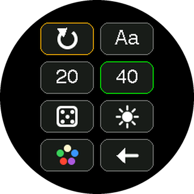 | 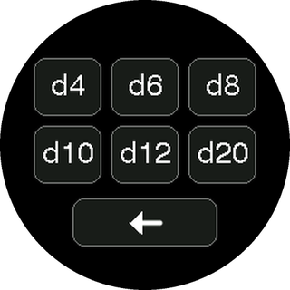 | 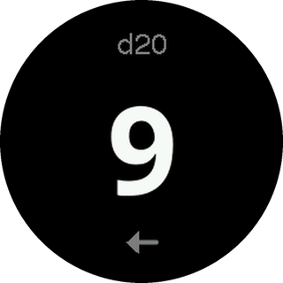 | 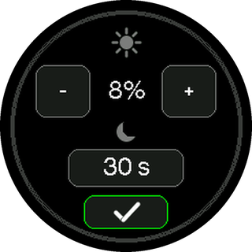 | 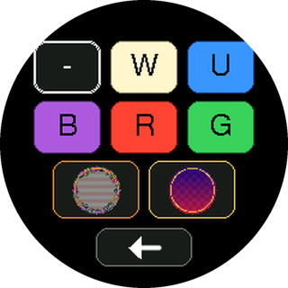 | 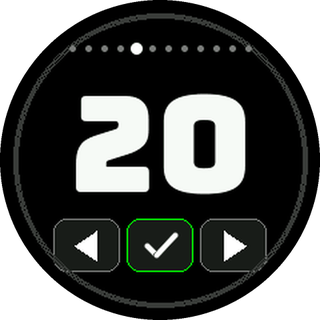 |

- **Menu:** reiniciar, fonte (Aa), nova partida com 20 ou 40, dado, brilho, tema e voltar.
- **Dado:** d4, d6, d8, d10, d12 e d20.
- **Brilho:** 1–100% e tempo para apagar a tela (nunca, 5 s até 5 min). O primeiro toque com a
  tela apagada só acende, sem mudar a vida.
- **Fonte:** 12 fontes para o número, com prévia.
- **Bateria baixa:** abaixo de 20% o brilho cai e a tela apaga mais cedo, até ligar o USB.

Vida, modo, tema, fonte, brilho e tempo de apagar ficam salvos e voltam ao religar.

## Hardware

- [Seeed Studio XIAO nRF52840](https://wiki.seeedstudio.com/XIAO_BLE/) (ou a versão Sense)
- [Seeed Studio Round Display for XIAO](https://wiki.seeedstudio.com/get_started_with_round_display/)
- Bateria LiPo 3,7 V de 1 célula (300–500 mAh) com conector JST 1,25 mm, ligada na Round Display.
  **Confira a polaridade com um multímetro antes de ligar**: há cabos vendidos com as cores
  invertidas.

Na Round Display, deixe as duas chaves da DIP pequena em **ON** (backlight e leitura da bateria).
A chave deslizante da borda liga e desliga o aparelho; a bateria carrega pelo USB-C do XIAO.

## Instalar o firmware

1. Baixe o arquivo **`mtg-life-counter-v0.1.0.uf2`** na
   [página de download](https://joaopedropio.github.io/mtg-life/#firmware).
2. Ligue o XIAO no computador pelo USB-C.
3. Dê **dois cliques rápidos no botão de reset** do XIAO. Aparece um drive chamado
   `XIAO-SENSE` (ou `XIAO-BOOT`).
4. Arraste o `.uf2` para esse drive. A placa grava, reinicia sozinha e o drive some.

Atualizar não apaga a vida salva, as configurações nem os temas personalizados. O `.uf2` usa o
bootloader de fábrica da Seeed (com o SoftDevice S140); se a placa já teve outro firmware que
trocou o bootloader, regrave o bootloader da Seeed antes.

### Compilar a partir do código

Pela Arduino IDE ou pelo `arduino-cli`:

```sh
arduino-cli config add board_manager.additional_urls https://files.seeedstudio.com/arduino/package_seeeduino_boards_index.json
arduino-cli core update-index
arduino-cli core install Seeeduino:nrf52@1.1.13       # "Seeed nRF52 Boards" (não a versão mbed)
git clone https://github.com/Seeed-Studio/Seeed_GFX        ~/Documents/Arduino/libraries/Seeed_GFX
git clone https://github.com/Seeed-Studio/Seeed_Arduino_FS ~/Documents/Arduino/libraries/Seeed_Arduino_FS

arduino-cli compile -b Seeeduino:nrf52:xiaonRF52840 mtg_life_counter
arduino-cli upload  -b Seeeduino:nrf52:xiaonRF52840 -p /dev/cu.usbmodemXXXX mtg_life_counter
```

O build precisa de um comando `python` no PATH e do `adafruit-nrfutil` (`pipx install
adafruit-nrfutil`). Para desenvolver, `#define DEBUG 1` no topo do sketch liga o log serial e
os comandos de teste. Detalhes técnicos e decisões de projeto estão em [NOTES.md](NOTES.md).

## Estrutura

```
mtg_life_counter/   firmware (sketch Arduino + fontes geradas)
docs/               editor de temas (site) e firmware para download
tools/              geração das fontes, testes de BLE e scripts de gravação
```
